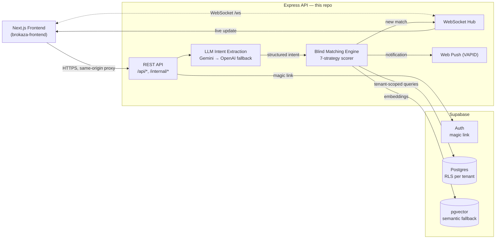

# Brokaza — Backend

> Multi-tenant API for blind property matching between real estate agencies — Node.js, TypeScript, Express, Supabase, LLM intent extraction.

## Overview

**Brokaza** is a multi-tenant backend that lets real estate agencies list their own property
inventory and publish search requests in natural language. An LLM-powered pipeline extracts
structured intent from that free text and matches it — *blindly* — against every other agency's
portfolio: each tenant only ever sees its own catalog, and a match surfaces as a targeted
notification rather than exposing a competitor's full inventory. This lets competing agencies
collaborate on deals without giving up their book of business.

### Key features

- **Blind cross-tenant matching engine** — 7-strategy scored pipeline (operation, property type, country, zone, bedrooms, budget, features) with short-circuit on hard disqualifiers
- **LLM-based intent extraction** from free-text search requests (Google Gemini primary, OpenAI automatic fallback), with Zod-validated structured output and prompt-injection hardening
- **Semantic fallback matching** via `pgvector` embeddings — resolves colloquial zone references and loosely-worded property features that exact/keyword matching misses
- **Multi-tenancy enforced at the database layer** — Postgres Row-Level Security scoped per request, not just application-level checks
- **Passwordless auth** (Supabase magic links) with an agency owner/collaborator role model and a dedicated admin panel API
- **LLM observability** — per-call cost/latency tracking, Langfuse tracing, and a structured eval suite (accuracy × cost × latency per model) used to justify model selection with real data
- **650+ automated tests** (Node's native test runner), enforced on every PR via CI

### Tech stack

Node.js · TypeScript (strict) · Express 5 · Supabase (Postgres, Auth, Realtime) · Google Gemini & OpenAI · pgvector · Resend · Web Push (VAPID) · Langfuse

**Frontend:** [github.com/rafalobop/brokaza-frontend](https://github.com/rafalobop/brokaza-frontend)

### Architecture



### Key design decisions

- **Matching is "blind" by design.** A tenant only ever sees *matches*, never another agency's inventory — the matching engine reads across tenants with the service-role client and an explicit `tenant_id` exclusion, but no tenant-facing endpoint ever exposes another agency's catalog. This lets competing agencies collaborate on deals without giving up their book of business.
- **Multi-tenancy is enforced with Postgres RLS, not application code.** Every tenant-scoped request carries the user's own Supabase JWT (`getTenantClient`), so row-level security — not a `WHERE tenant_id = ?` a developer might forget — is the actual isolation boundary. Background jobs with no user session are the deliberate exception, using the service-role client.
- **Gemini primary, OpenAI automatic fallback — chosen from real data, not a guess.** An eval suite (`evals/`, `docs/model-selection.md`) measures accuracy × cost × latency per model on real search requests; Gemini wins on cost/speed for this workload, OpenAI's Structured Outputs give a reliable fallback when Gemini's quota or a transient error cuts in.
- **Rate limiting lives in Postgres, not Redis.** The stack already has zero infra beyond Supabase; a `rate_limit_check` RPC backed by Postgres avoids standing up a separate service just for request counters at this scale (trade-off documented in `docs/rate-limit-backends.md`).

### Note on ticket references

Commit messages and `.agent/CONTEXT.md` reference ticket IDs like `KAN-xxx`. These come
from a self-built LangGraph multi-agent tool (PO/PM/Tech Lead/QA simulated debate) used to
plan and track work on this solo project — not an external Jira instance. The tool itself
lives in a separate, gitignored workspace (`langgraph-tools/`) and isn't part of the
deployed app.

---

*The sections below are written in Spanish, this project's original development language (built for the real estate market in Tucumán, Argentina).*

---

## Descripción (ES)

API de Brokaza: matching ciego de propiedades entre inmobiliarias (Tucumán, Argentina). Cada tenant
(agente/inmobiliaria) carga su cartera de propiedades vía Excel y publica búsquedas en texto libre;
el backend extrae la intención con IA (Gemini, con fallback a OpenAI) y cruza esa búsqueda contra la
cartera de **otros** tenants (nunca la propia) — de ahí "ciego": ningún tenant ve el catálogo ajeno,
solo recibe avisos de matches puntuales.

Repo separado del frontend (`brokaza-frontend`, Next.js) desde KAN-145 — este repo expone solo API
(`/api/*`, `/internal/*`, `/health`, WebSocket en `/ws`), incluidas las rutas del panel admin
(`src/adminRoutes.ts`). El panel admin en sí (login, métricas, listado/corrección de propiedades)
vive como UI en `brokaza-frontend/src/app/admin` (Next.js) — el bundle estático legacy
(`src/admin-dashboard/`) se retiró en KAN-342.

## Stack

- **Node.js + TypeScript** (Express 5, `strict: true` en `tsconfig.json`)
- **Supabase** (Postgres + Auth + Realtime vía WebSocket propio, no el de Supabase) como única base de datos, con RLS multi-tenant
- **Gemini** (primario) + **OpenAI** (fallback automático) para extracción de intención de búsqueda en texto libre
- **Resend** para el envío de emails (magic link de auth + notificaciones)
- **Web Push (VAPID)** para notificaciones push del dashboard
- Test runner nativo de Node (`node:test`), sin Jest ni supertest

## Arquitectura del código

```
src/
├── index.ts              # bootstrap del proceso: handlers de unhandledRejection/uncaughtException,
│                          # arranca servicios de fondo, crea el server HTTP y hace listen()
├── app.ts                # createApp(): Helmet/CSP, express.json, cookieParser, monta el panel
│                          # admin, GET /health, estáticos de public/, y el router de src/routes/
├── adminRoutes.ts         # rutas de API del panel admin (app.admin.brokaza.com) — cross-tenant,
│                          # montadas aparte, solo si ADMIN_HOST está seteada. La UI vive en
│                          # brokaza-frontend (Next.js), no acá (KAN-342).
├── middleware/            # tenantAuthMiddleware (auth de tenant) y afines
├── routes/*Routes.ts      # un router por dominio: auth, profile, upload, catalog, search, matches,
│                          # notifications, internal — define paths/middleware (auth, rate limit)
├── controllers/*Controller.ts  # la lógica de request/response de cada router, en pares 1:1
├── ai/                     # capa de IA (BE-06): schemas/ (un schema Zod por operación),
│                          # providers/ (GeminiProvider/OpenAIProvider/FallbackProvider),
│                          # operations/ (extractFromTextInput, extractZoneIntent,
│                          # segmentSearchRequests, suggestExcelColumnMapping), prompts.ts,
│                          # index.ts (único punto de entrada público)
├── services/               # lógica de negocio pura: blindMatching.ts (motor de matching),
│                          # excel.ts (parseo de cartera), webPush.ts, notifier-email.ts,
│                          # realtimeHub.ts (WebSocket), searchExpiration.ts, llmCallsRepository.ts
│                          # (persistencia de métricas de IA), tracing.ts (Langfuse), etc.
├── config/env.ts          # validación fail-fast de variables de entorno al arrancar
├── utils/                 # helpers puros (rate limiting, validaciones, whitelist de body, etc.)
└── types/database.types.ts # tipos generados desde el schema real de Supabase (no se edita a mano)
```

## Autenticación

**Tenants** (`src/routes/authRoutes.ts` + `src/controllers/authController.ts`): magic link vía
Supabase Auth. Flujo: el usuario pide un link (`POST /api/auth/request-magic-link`, rate-limited por
IP y por email) → lo recibe por email (Resend, no el mail default de Supabase) → al hacer clic,
el frontend intercambia el token (`POST /api/auth/exchange-token`) → cookie HttpOnly
`brokaza_session`. `tenantAuthMiddleware` valida esa cookie contra Supabase Auth en cada request
(con una caché en memoria de 30s para no pegarle a Supabase en cada request).

**Admin** (`src/adminRoutes.ts` + `src/adminAuth.ts`): mismo mecanismo de magic link, pero
completamente aislado — cookie, allowlist de emails y router propios, montado solo cuando la request
llega con `Host === ADMIN_HOST`. Nunca comparte sesión ni rutas con el flujo de tenant.

No hay OTP ni binding por IP — esa arquitectura (documentada en versiones viejas de este archivo) se
reemplazó por completo con el magic link de Supabase Auth.

## Multi-tenancy

Todas las tablas de negocio tienen `tenant_id` y RLS (`tenant_id = auth.uid()`). El patrón real
(KAN-63, "Tenant Context"): cada request autenticado de tenant recibe `req.supabaseClient`, un
cliente Supabase scoped al usuario real (anon key + su `access_token` como Bearer) — RLS se aplica
de verdad en cada query, no solo como defensa en profundidad teórica. Los procesos de fondo sin
sesión de usuario (crons, notificadores) usan el cliente service-role a propósito.

## Empezar local

```bash
pnpm install
cp .env.example .env   # completar los valores, ver sección de abajo
pnpm run dev            # ts-node, con reload manual (no hot-reload)
```

El servidor **no arranca** si faltan variables de entorno requeridas (`src/config/env.ts`, fail-fast
por diseño). Levanta en `http://localhost:3000` por default.

## Variables de entorno

Copiá `.env.example` a `.env`. Variables requeridas (sin default, el arranque falla si faltan):

- `GEMINI_API_KEY`
- `SUPABASE_URL`, `SUPABASE_SERVICE_ROLE_KEY`, `SUPABASE_ANON_KEY`, `SUPABASE_JWT_SECRET`
- `INTERNAL_WEBHOOK_SECRET` — secreto de `POST /internal/property-match-check`, llamado por un trigger de Postgres
- `SENDER_API_KEY` (Resend) — el magic link (login de tenant y admin) se manda por acá, sin esto nadie puede loguearse
- `VAPID_PUBLIC_KEY` / `VAPID_PRIVATE_KEY`: claves del protocolo Web Push (`src/services/webPush.ts`). Generalas con:
  ```
  npx web-push generate-vapid-keys
  ```
  **No hay valores por default hardcodeados en el código** (KAN-81) — son secretos propios de cada entorno. En Railway (producción/staging) ya están seteadas; en local, agregalas a tu `.env`.

`ALLOW_MISSING_SUPABASE_CREDENTIALS=true` permite arrancar sin `SUPABASE_URL`/`SUPABASE_SERVICE_ROLE_KEY` (solo para desarrollo local sin Supabase configurado todavía — **nunca en producción**; ojo que igual hace falta una `SUPABASE_URL` con formato válido para el cliente scoped a tenant, ver `getTenantClient`).

El resto de las variables documentadas en `.env.example` (rate limits, `ADMIN_HOST`, `APP_URL`, tamaños de pool de parseo de Excel, etc.) son opcionales y tienen defaults razonables en `src/config/env.ts`.

## Tests

```bash
pnpm test         # node:test vía tests/runner.ts — todos los archivos de tests/ en un solo proceso
pnpm run build     # tsc, sin emitir dist/ en dev (usalo para chequear tipos)
```

Sin harness de supertest/Express en este repo — los tests de rutas invocan los controllers
directamente con request/response fake, y todo lo externo (Supabase, Gemini/OpenAI, Resend, Web
Push) va mockeado con `t.mock.method`. Ningún test pega a red real.

## CI

`.github/workflows/ci.yml` (KAN-281): en cada PR/push a `master`/`development` corre
`pnpm install --frozen-lockfile && pnpm run build && pnpm test` sobre Node 22. Las variables de entorno que requiere
`config/env.ts` van como placeholders inline en el workflow (no hacen falta secrets reales, ningún
test pega a red) — única excepción, `VAPID_PUBLIC_KEY`/`VAPID_PRIVATE_KEY` sí necesitan el formato
real de un par de claves EC porque `web-push` los valida al importar el módulo.

## Tipado de las respuestas de Supabase (KAN-139)

`src/services/supabase.ts` expone `supabase` (cliente service-role) y `getTenantClient(token)`
(cliente scoped al tenant) tipados como `TypedSupabaseClient` = `SupabaseClient<Database>`.
`Database` vive en `src/types/database.types.ts`, generado directamente desde el schema real del
proyecto de Supabase — **no se edita a mano**.

Implicancias para código nuevo:
- Cualquier `.from('tabla')` sobre `supabase` o `getTenantClient(...)` tipa `select`/`insert`/`update`/`delete`/`eq`/etc. contra las columnas reales — un typo o un tipo que no matchea es error de compilación, no un `any` silencioso.
- Si una función recibe un `SupabaseClient` inyectado como parámetro (patrón usado para poder testear sin red real), tipalo como `TypedSupabaseClient`.
- **Regenerar `database.types.ts` cada vez que cambie el schema real**: `mcp__supabase__generate_typescript_types`, o `supabase gen types typescript --project-id <project-id>` con la CLI.

## Formulario de perfil de tenant (KAN-90)

Tras el primer login por magic link, el agente completa un formulario obligatorio
(`POST /api/profile`, validado en `src/utils/profileValidation.ts`) antes de poder usar el
dashboard.

| Campo | Requerido | Reglas |
|---|---|---|
| Nombre (`first_name`) | Sí | 2–100 caracteres. Solo letras (con acentos/ñ), espacios, guiones y apóstrofes. |
| Apellido (`last_name`) | Sí | Mismas reglas que Nombre. |
| Código de país (`phone_country_code`) | Sí | Formato `+` seguido de 1 a 4 dígitos (ej. `+54`). |
| Teléfono local (`phone_local_number`) | Sí | Exactamente 10 dígitos — código de área (3) + número (7). |
| Matrícula (`license_number`) | Sí, salvo colaborador (`role='collaborator'`) | Solo dígitos, máximo 10 caracteres. Se valida contra el padrón real del CCIT y se rechaza con `409` si otro tenant ya la tiene registrada (índice único parcial en DB, KAN-306). |
| Inmobiliaria (`agency_name`) | Sí, salvo colaborador (hereda la del dueño) | Máximo 150 caracteres, sin restricción de charset. |
| Ciudad (`city`) | Sí | Máximo 150 caracteres — combobox de localidades reales de Tucumán (API Georef), con opción "Otra localidad...". |

`first_name`/`last_name` se combinan en `profiles.full_name` al persistir (no tienen columnas
propias). **País/Provincia fijos a Argentina/Tucumán** (KAN-93, decisión de negocio explícita): el
backend hardcodea `country = 'Argentina'` siempre, sin importar el payload.

**Roles de agencia y colaboradores (KAN-306):** `profiles.role` distingue `owner` de
`collaborator`. Un dueño (`role='owner'`) gestiona colaboradores desde
`POST/GET/DELETE /api/admin-panel/collaborators` (`src/routes/adminPanelRoutes.ts` +
`adminPanelController.ts`) — invitarlos por email (creando la cuenta si no existe, junto con el
magic link de bienvenida), revocarlos o reactivarlos. Los colaboradores operan bajo la matrícula e
inmobiliaria del dueño (`agency_owner_id`), sin necesitar las propias. Ver
`docs/rls-deny-all-tables-README.md` para el detalle de `licensed_agents` (caché local del padrón
del CCIT usado para validar la matrícula).

## Otros documentos

- `docs/RUNBOOK.md` — observabilidad y alertas de errores en producción (healthcheck, Sentry).
- `docs/rate-limit-backends.md` — por qué el rate limiting distribuido usa Postgres y no Redis.
- `docs/rls-deny-all-tables-README.md` — por qué `licensed_agents` y la familia `neighborhood_*` tienen RLS habilitado sin policies (intencional, solo acceso service-role).
- `docs/model-selection.md` — comparativa de modelos LLM (accuracy × costo × latencia) y la justificación con datos de por qué `gemini-2.5-flash-lite` es el primario y `gpt-4o-mini` el fallback.
- `.agent/CONTEXT.md` — memoria viva del proyecto: arquitectura al detalle, historial de decisiones y tracking de tickets. Fuente de verdad más granular que este README.
